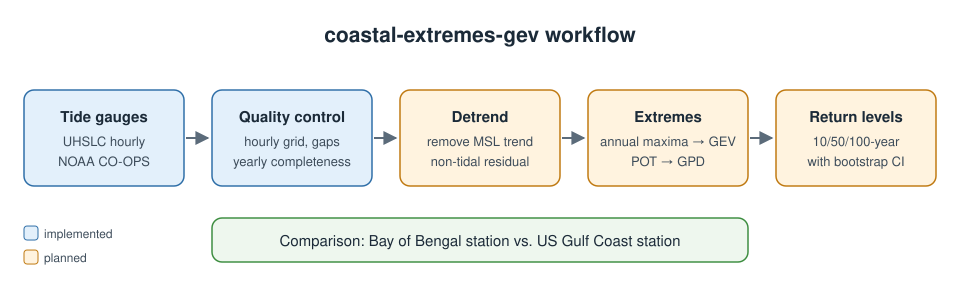
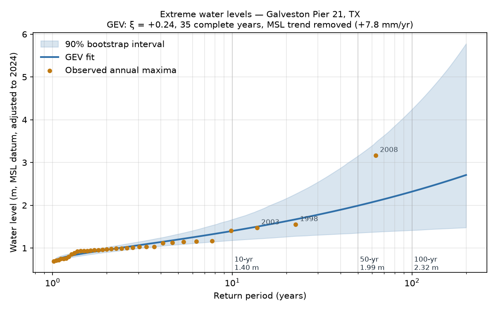

# coastal-extremes-gev

[](https://github.com/hrahmanwave/coastal-extremes-gev/actions/workflows/tests.yml)

<p align="center">
  
</p>

Extreme value analysis of coastal water levels from tide gauge records.
Download hourly sea level, quality-control it, extract extremes, and fit
GEV (annual maxima) and GPD (peaks over threshold) distributions to estimate return levels.

The goal is a side-by-side comparison of a Bay of Bengal station and a US Gulf Coast station.

> **Status:** early development. Data download and quality control are in place;
> detrending and distribution fitting are next.

## Installation

```bash
git clone https://github.com/hrahmanwave/coastal-extremes-gev.git
cd coastal-extremes-gev
pip install -e ".[dev]"
```

## Usage (so far)

```python
from cextremes import fetch_coops_hourly, to_regular_hourly, completeness_by_year, annual_maxima

s = fetch_coops_hourly("8771450", 1990, 2024)    # Galveston Pier 21, TX (MSL datum)
s = to_regular_hourly(s)
print(completeness_by_year(s).tail())
amax = annual_maxima(s, min_completeness=0.8)
```

Downloads are cached in `data/` (not tracked by git).

## Plot annual maxima

```bash
python scripts/plot_annual_maxima.py
python scripts/plot_annual_maxima.py --station 8761724 --name "Grand Isle, LA" --start 1990 --end 2024
```

Saves `figures/<station>_annual_maxima.png`: annual maximum water level with a linear trend,
and yearly data completeness (years with less than 80% data are excluded).

## Return levels

```bash
python scripts/return_levels.py --station 8771450 --name "Galveston Pier 21, TX"
```

Removes the linear mean sea level trend (relative to the last year), fits a GEV distribution
to annual maxima from complete years, and estimates 2- to 100-year return levels with 90%
bootstrap confidence intervals.



At Galveston Pier 21 (1990-2024, 35 complete years), mean sea level rose about 7.8 mm/yr.
The estimated 100-year water level is 2.32 m above MSL, with a wide 90% interval
(1.42-4.24 m): 35 years of data constrain a 100-year event only loosely.
## Roadmap

- [x] UHSLC research-quality hourly download
- [x] NOAA CO-OPS hourly download (year-by-year, cached)
- [x] Quality control: regular hourly grid, yearly completeness, annual maxima
- [x] Workflow diagram and annual maxima plotting script
- [x] Remove linear mean sea level trend, compute non-tidal residual
- [x] GEV fit to annual maxima with bootstrap confidence intervals
- [ ] Peaks over threshold + GPD, threshold selection
- [ ] Return level plots, Bay of Bengal vs. Gulf Coast comparison
- [ ] Non-stationary GEV (time-varying location)

## Data

- University of Hawaii Sea Level Center (UHSLC), research-quality hourly data
- NOAA CO-OPS Tides & Currents, verified hourly heights

## License

MIT
